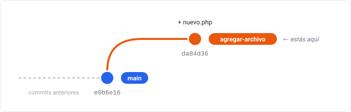
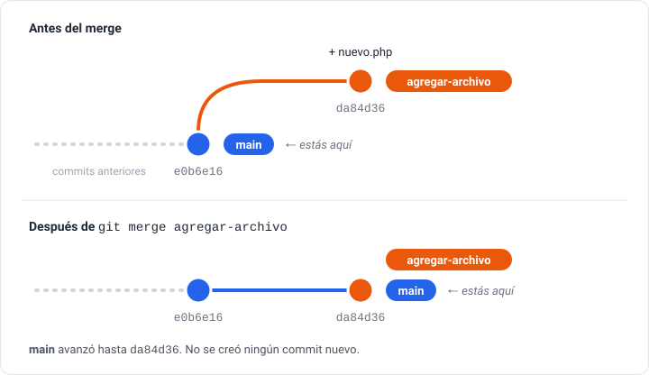
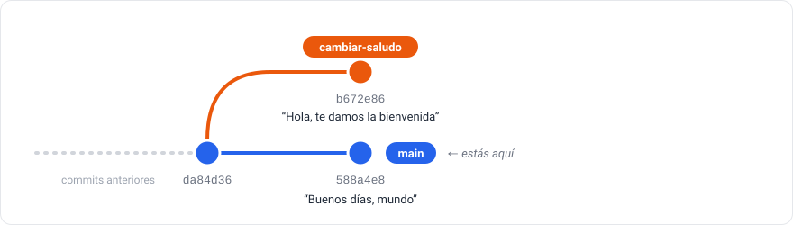
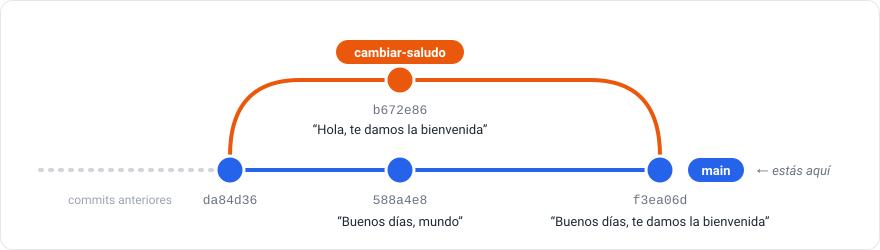

# Tema 6: Ramas y conflictos — Trabajar en paralelo sin miedo

> **Objetivo:** usar ramas para probar cambios sin afectar la versión principal del código, unirlas, y resolver un conflicto cuando dos ramas cambian lo mismo.
>
> **Antes de empezar:** entra en `mi-proyecto`. Tiene que tener los 8 commits del [tema 5](05_deshacer.md) y `git status` tiene que decir `working tree clean`.

## ¿Qué es una rama?

Imagina que tienes un cuaderno con tus apuntes y quieres probar a reorganizar un tema, pero no sabes si te va a quedar mejor. Fotocopias las páginas, trabajas sobre la copia y, si te gusta el resultado, reemplazas las originales. Si no, tiras la copia y listo.

En Git, una **rama** (branch) es esa fotocopia, pero virtual. Creas una rama, pruebas lo que quieras, y:

- si funciona, la **unes** (merge) a la rama principal;
- si no funciona, la borras y no pasa nada.

La rama principal se llama `main`. Lo que hagas en otra rama **no afecta a `main`** hasta que decidas unirlo.

Palabras que vas a ver:

- **branch:** rama.
- **switch:** cambiar de una rama a otra.
- **merge:** unir los cambios de una rama en otra.

> **En otros tutoriales** vas a ver `git checkout` en lugar de `git switch` (`git checkout -b rama` para crear, `git checkout main` para cambiar). Hacen lo mismo. `git switch` es más nuevo y se usa solo para ramas, por eso es más fácil de recordar.

## Ver en qué rama estás

`git branch` lista las ramas que existen. La rama en la que estás tiene un asterisco (`*`).

### ✍️ Tu turno

```bash
git branch
```

```
* main
```

Hay una sola rama, `main`, y estás en ella.

## Crear una rama nueva

`git switch -c nombre` crea una rama nueva y te cambia a ella en un solo paso (la `-c` viene de "create", crear).

### ✍️ Tu turno: crear la rama agregar-archivo

```bash
git switch -c agregar-archivo
```

```
Switched to a new branch 'agregar-archivo'
```

Verifícalo:

```bash
git branch
```

```
* agregar-archivo
  main
```

El asterisco ahora está en `agregar-archivo`. Todo lo que guardes a partir de ahora queda en esta rama.

## Hacer cambios en la rama

### ✍️ Tu turno: un commit dentro de la rama

Crea un archivo `nuevo.php`, con un editor o con este comando:

```bash
echo '<?php echo "Este archivo fue creado en una rama"; ?>' > nuevo.php
```

Guárdalo en el historial:

```bash
git add nuevo.php
git commit -m "Agrega archivo nuevo.php desde la rama"
```

```
[agregar-archivo da84d36] Agrega archivo nuevo.php desde la rama
 1 file changed, 1 insertion(+)
 create mode 100644 nuevo.php
```

Fíjate que entre corchetes ahora dice `agregar-archivo` y no `main`. Este commit solo existe en esta rama:



## Volver a main

### ✍️ Tu turno: comprobar que main no cambió

```bash
git switch main
```

```
Switched to branch 'main'
```

> 🤔 **Antes de ejecutarlo, piensa:** `nuevo.php` está en tu carpeta desde hace un minuto. Ahora que volviste a `main`, ¿va a aparecer en la lista de archivos?

```bash
ls
```

<details>
<summary>Ver lo que deberías ver</summary>

```
ayuda.php  contacto.php  hola.php
```

`nuevo.php` desapareció de la carpeta. No se borró: sigue guardado en la rama `agregar-archivo`. Cuando cambias de rama, Git deja la carpeta como está en esa rama. Esto es lo poderoso de las ramas: cada una tiene su propia versión de los archivos.

</details>

## Unir los cambios (merge)

Cuando estás conforme con los cambios de una rama, los unes con `git merge`. Importante: tienes que estar en la rama que **recibe** los cambios, en este caso `main`.

### ✍️ Tu turno: unir la rama a main

Ya estás en `main` (si no estás segura, ejecuta `git branch`). Une los cambios:

```bash
git merge agregar-archivo
```

```
Updating e0b6e16..da84d36
Fast-forward
 nuevo.php | 1 +
 1 file changed, 1 insertion(+)
 create mode 100644 nuevo.php
```

"Fast-forward" quiere decir que `main` no había cambiado desde que creaste la rama, así que Git solo tuvo que adelantar `main` hasta el último commit de la rama.



```bash
ls
```

```
ayuda.php  contacto.php  hola.php  nuevo.php
```

Ahora `nuevo.php` también está en `main`.

## Borrar la rama

Una vez que los cambios están en `main`, la rama ya no hace falta:

```bash
git branch -d agregar-archivo
```

```
Deleted branch agregar-archivo (was da84d36).
```

Borrar la rama no borra sus commits: ya forman parte de `main`.

## Conflictos: cuando dos ramas cambian lo mismo

En el merge anterior todo fue automático, porque solo una de las dos ramas había cambiado. Pero en la vida real, mientras trabajas en una rama, `main` también cambia. Si las dos ramas modificaron **partes distintas**, Git las combina solo. Si modificaron **la misma línea**, Git no puede saber con qué versión quedarse, y te pide que decidas tú. Eso es un **conflicto**.

Un conflicto no es un error ni significa que rompiste algo. Es Git preguntándote algo que no puede decidir solo. Vamos a provocar uno a propósito para que veas que se resuelve con calma.

### ✍️ Tu turno: provocar un conflicto

**1. En una rama nueva, cambia el saludo** de `hola.php` ("Hola mundo" pasa a ser "Hola, te damos la bienvenida"):

```bash
git switch -c cambiar-saludo
echo '<?php echo "Hola, te damos la bienvenida"; echo "Adiós mundo"; echo "Versión 3"; ?>' > hola.php
git add hola.php
git commit -m "Cambia el saludo por una bienvenida"
```

**2. Vuelve a `main` y cambia el mismo saludo de otra forma** ("Hola mundo" pasa a ser "Buenos días, mundo"):

```bash
git switch main
echo '<?php echo "Buenos días, mundo"; echo "Adiós mundo"; echo "Versión 3"; ?>' > hola.php
git add hola.php
git commit -m "Cambia el saludo por buenos días"
```

Ahora cada rama tiene un commit que la otra no tiene, y los dos tocan la misma línea:



**3. Intenta unir la rama:**

```bash
git merge cambiar-saludo
```

```
Auto-merging hola.php
CONFLICT (content): Merge conflict in hola.php
Automatic merge failed; fix conflicts and then commit the result.
```

Git avisa que hay un conflicto en `hola.php` y que el merge quedó a medio hacer.

### Entender el conflicto

```bash
git status
```

```
On branch main
You have unmerged paths.
  (fix conflicts and run "git commit")
  (use "git merge --abort" to abort the merge)

Unmerged paths:
  (use "git add <file>..." to mark resolution)
	both modified:   hola.php

no changes added to commit (use "git add" and/or "git commit -a")
```

`both modified` significa que las dos ramas modificaron ese archivo. Mira cómo quedó:

```bash
cat hola.php
```

```
<<<<<<< HEAD
<?php echo "Buenos días, mundo"; echo "Adiós mundo"; echo "Versión 3"; ?>
=======
<?php echo "Hola, te damos la bienvenida"; echo "Adiós mundo"; echo "Versión 3"; ?>
>>>>>>> cambiar-saludo
```

Git escribió **las dos versiones** en el archivo, separadas por marcas:

- Entre `<<<<<<< HEAD` y `=======` está la versión de la rama donde estás (`main`).
- Entre `=======` y `>>>>>>> cambiar-saludo` está la versión que viene de la otra rama.

### Resolver el conflicto

Resolver un conflicto es **editar el archivo para que quede como quieres** y borrar las tres líneas de marcas. Puedes quedarte con una versión, con la otra, o combinarlas. Vamos a combinarlas.

#### ✍️ Tu turno: resolver

Abre `hola.php` en tu editor y déjalo con una sola línea, sin marcas:

```php
<?php echo "Buenos días, te damos la bienvenida"; echo "Adiós mundo"; echo "Versión 3"; ?>
```

o reemplázalo con este comando:

```bash
echo '<?php echo "Buenos días, te damos la bienvenida"; echo "Adiós mundo"; echo "Versión 3"; ?>' > hola.php
```

> Si usas **VS Code**, al abrir un archivo con conflicto aparecen botones arriba de las marcas: "Accept Current Change" (quedarte con la tuya), "Accept Incoming Change" (quedarte con la otra) y "Accept Both Changes" (las dos). Son atajos para lo mismo: editar el archivo y quitar las marcas.

Avísale a Git que el conflicto está resuelto, con `git add`, como sugería `git status`:

```bash
git add hola.php
git status
```

```
On branch main
All conflicts fixed but you are still merging.
  (use "git commit" to conclude merge)

Changes to be committed:
	modified:   hola.php
```

Termina el merge con un commit. `--no-edit` usa el mensaje automático, sin abrir el editor:

```bash
git commit --no-edit
```

```
[main f3ea06d] Merge branch 'cambiar-saludo'
```

Este commit se llama **commit de merge**: une las dos líneas de trabajo. Puedes verlo dibujado con `--graph`:

```bash
git log --oneline --graph -5
```

```
*   f3ea06d Merge branch 'cambiar-saludo'
|\
| * b672e86 Cambia el saludo por una bienvenida
* | 588a4e8 Cambia el saludo por buenos días
|/
* da84d36 Agrega archivo nuevo.php desde la rama
* e0b6e16 Revert "Agrega aviso de mantenimiento"
```

Es el mismo historial que este dibujo, pero `git log` lo muestra de abajo (lo más antiguo) hacia arriba (lo más reciente):



Las dos líneas de trabajo se separan y vuelven a juntarse en el commit de merge. Ya puedes borrar la rama:

```bash
git branch -d cambiar-saludo
```

> **¿Te arrepentiste en medio de un conflicto?** Mientras no hayas hecho el commit final, `git merge --abort` cancela el merge y deja todo como estaba antes de empezarlo.

## Resumen del flujo con ramas

```bash
# 1. Crear la rama y cambiarte a ella
git switch -c nombre-de-la-rama

# 2. Hacer cambios, add y commit
git add archivo.php
git commit -m "Descripción del cambio"

# 3. Volver a main
git switch main

# 4. Unir los cambios
git merge nombre-de-la-rama
#    Si hay conflicto: editar el archivo, quitar las marcas,
#    git add archivo.php y git commit --no-edit

# 5. Borrar la rama
git branch -d nombre-de-la-rama
```

## 🧩 Desafío

Crea una rama llamada `experimento`, haz en ella un commit con un archivo nuevo cualquiera y vuelve a `main`. Ahora decides que el experimento no sirvió: **borra la rama sin unirla a `main`**.

Antes de empezar, piensa: ¿qué va a pasar cuando intentes borrarla con `git branch -d`, como hiciste antes?

<details>
<summary>Ver una solución</summary>

```bash
git switch -c experimento
echo '<?php echo "prueba"; ?>' > experimento.php
git add experimento.php
git commit -m "Prueba un experimento"
git switch main
git branch -d experimento
```

```
error: the branch 'experimento' is not fully merged.
If you are sure you want to delete it, run 'git branch -D experimento'
```

Git no te deja: la rama tiene un commit que no está en `main`, y si la borras ese trabajo se pierde. Es una protección. Como estás segura, usa `-D` (mayúscula), como sugiere el mensaje:

```bash
git branch -D experimento
```

```
Deleted branch experimento (was e29b26a).
```

`experimento.php` nunca llegó a `main`, así que no aparece en tu carpeta.

</details>

## ✅ Comprueba que todo salió bien

```bash
git branch
```

Solo tiene que quedar `main`:

```
* main
```

```bash
cat hola.php
```

```
<?php echo "Buenos días, te damos la bienvenida"; echo "Adiós mundo"; echo "Versión 3"; ?>
```

```bash
git log --oneline -4
```

```
f3ea06d Merge branch 'cambiar-saludo'
588a4e8 Cambia el saludo por buenos días
b672e86 Cambia el saludo por una bienvenida
da84d36 Agrega archivo nuevo.php desde la rama
```

(El orden de los dos commits del medio puede variar.) Y `git status` tiene que decir `working tree clean`.

---

**Siguiente:** [Tema 7: GitHub](07_github.md)
